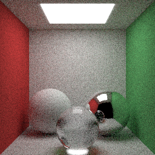

# PathTracerBVH

A C++17 Monte Carlo path tracer with a bounding volume hierarchy for triangle meshes. It includes two Cornell box scenes and a furnace test.

## Build and run

From the repository root, use GNU Make and a C++17 compiler.

```sh
make -j
./pt -w 256 -h 256 -s 64 -S 1 -o image.ppm
```

Run `./pt -S 2 -D 3` for the furnace test. Its maximum pixel error should be zero. Use `make clean` to remove the executable and build files.

Implementation files are in `src/`, and headers are in `src/include/`. See the [assignment and command-line options](src/problem.md).


